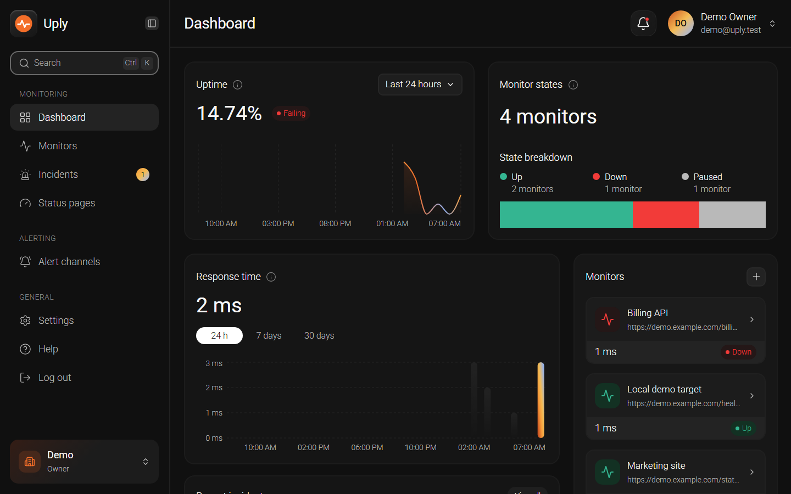
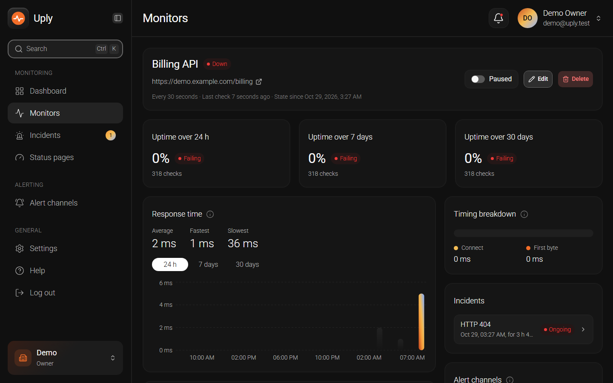
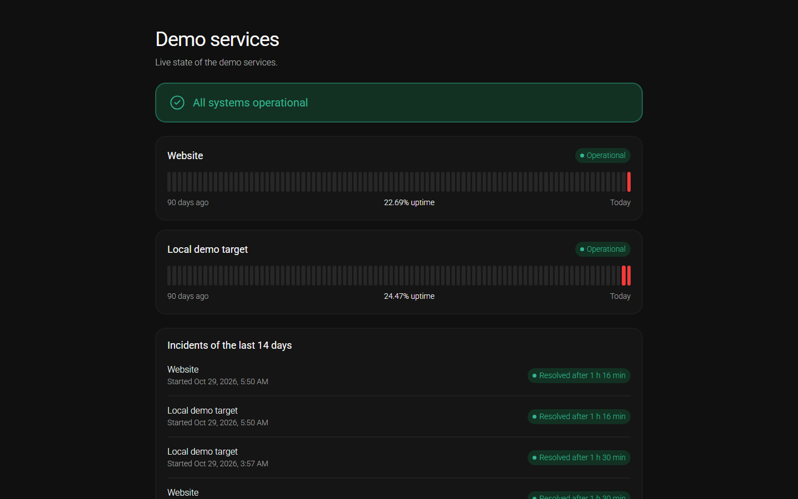

<p align="center"></p>
<h1 align="center">Uply</h1>
<p align="center">Uptime monitoring for websites and APIs.</p>
<p align="center">   <a href="LICENSE"></a></p>

## Features

- HTTP and HTTPS checks
- Response time and uptime
- Keyword, headers and body checks
- Incidents
- Email, Discord and Slack alerts
- Reminders and flapping alerts
- TLS certificate expiry alerts
- Maintenance windows
- Public status pages
- Real time dashboard
- Organizations, roles and invitations
- Two factor auth

## Screenshots







## Stack

- API: Laravel 13, PHP 8.5, PostgreSQL 18, Reverb
- Web: React 19, TypeScript, Vite, Tailwind CSS, shadcn/ui
- CI: GitHub Actions

## Run locally

Needs PHP 8.5, PostgreSQL 18, Node 24 and Mailpit.

```bash
cd api
composer install
cp .env.example .env
php artisan key:generate
php artisan migrate
php artisan db:seed --class=DemoSeeder
```

In `.env`: `REVERB_APP_ID`, `REVERB_APP_KEY`, `REVERB_APP_SECRET`, and `MONITORING_ALLOW_PRIVATE_TARGETS=true` for local targets.

```bash
php artisan serve
php artisan reverb:start --host=127.0.0.1 --port=6001
php artisan schedule:work
php artisan queue:work --queue=alerts,realtime,checks,default
```

```bash
cd web
npm ci
npm run dev
```

Open `http://localhost:5173`, sign in with `demo@uply.test` and `password`.

## Configuration

Defaults in `api/config/`.

<details><summary>Main defaults</summary>

| Setting | Default |
|---|---|
| Check interval | 60 s, 30 s to 1 h |
| Timeout | 10 s, max 30 s |
| Confirmation | 2 checks, 1 to 10 |
| Recheck | 20 s |
| Raw results | 30 days |
| Hourly stats | 400 days |
| Monitors per organization | 100 |
| Alert tries | 5 |
| Reminders | off, 15 min to 24 h |
| Flapping | 5 changes in 30 min |
| Maintenance window | max 7 days |
| Status pages per organization | 10 |
| API rate limit | 120 requests per minute |

</details>

## Test

```bash
cd api
composer lint
composer analyse
composer test
```

```bash
cd web
npm run lint
npm run typecheck
npm test
npm run build
npm run e2e
```

## Limits

- HTTP and HTTPS only
- One check location
- No hosting, no billing
- English only, dark theme only
- Fixed roles, no teams
- No custom domains
- Discord and Slack not tested live

## Status

Portfolio project, in progress.

## License

MIT, see [LICENSE](LICENSE).
